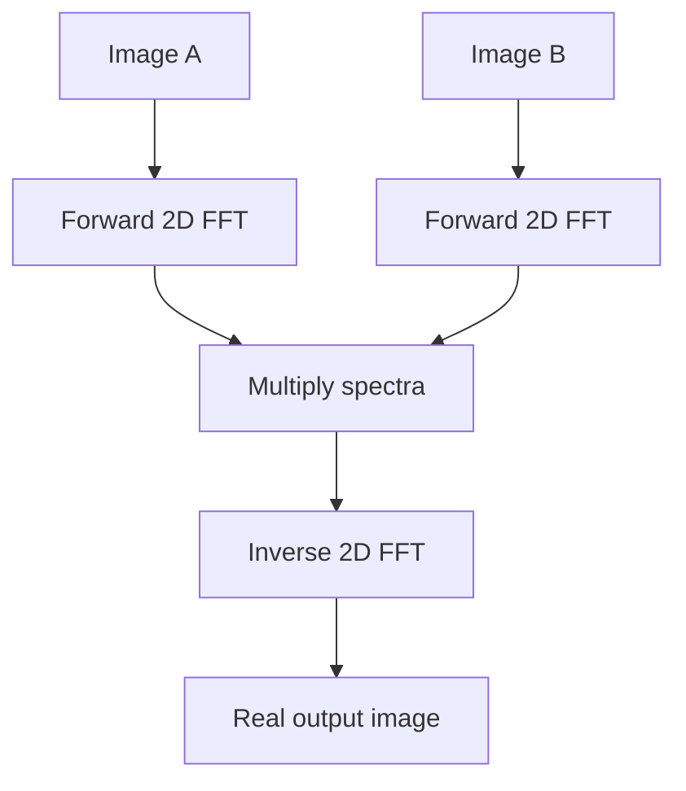

# Final project · 2D FFT convolution

[convolve.c](convolve.c) computes the circular convolution of two real
512 × 512 images. Each input is a grid of ASCII numbers and the output is
another grid. In a direct calculation, each input pair contributes to the
output at the sum of their coordinates, modulo 512. The wraparound follows
from doing the Fourier transforms on the original grid size.

## Why use the FFT?

The convolution theorem turns a convolution into an elementwise product
in the frequency domain. The code treats each input value as a complex
number with zero imaginary part. It then computes



A 2D FFT is separable. `fft2` transforms each row using `c_fft1d`
from [fft.c](fft.c), transposes the array, then transforms the new rows
(which were the original columns). A second transpose restores the
original axes. The inverse divides by the side length in each dimension.
Processing an $n$ × $n$ image this way takes $O(n^2\log n)$ arithmetic.

## How work moves between ranks

| Executable | Division of work |
| --- | --- |
| `conv_serial` | One process performs the full pipeline and provides a baseline. |
| `conv_sendrecv` | One MPI group divides each stage into row slabs. The root scatters and gathers slabs using `MPI_Send` and `MPI_Recv`. |
| `conv_collective` | The same row-slab stages exchange data using `MPI_Scatterv` and `MPI_Gatherv`. |
| `conv_tasks` | Eight ranks form four two-rank groups with `MPI_Comm_split`. The two forward FFT groups can run concurrently. |

For both SPMD variants, `create_layout` computes each rank's pixel count
and offset, even when the rank count does not divide 512. The root
performs the transpose between the row FFT stages, which concentrates
memory and communication on that rank. The pointwise product is divided
into slabs as well.

For the task variant, world ranks 0–1 transform image A and 2–3 transform
image B. Their leaders send both spectra to ranks 4–5 for multiplication.
That group sends the product to ranks 6–7 for the inverse FFT, whose leader
returns the result to world rank 0 for writing. Group-level work uses the
split communicators and leader-to-leader transfers use the world communicator.

## Read the timings and check the output

The MPI timing excludes file I/O. `total_s` is the maximum elapsed
duration across ranks. `compute_max_s` and `communication_max_s` are
separate rank maxima, so adding them may combine times from different ranks.
Communication time includes waiting within MPI calls.

After building, run the standalone checker from the
[repository root](../README.md). It independently computes a sparse direct
convolution with asymmetric inputs, which exercises wraparound and axis
ordering:

```sh
python3 tests/check_convolution.py build/conv_serial \
    "mpiexec -n 4 build/conv_collective" "mpiexec -n 8 build/conv_tasks"
```

See [verification results](../DESIGN.md#local-verification) for the tested
configurations and the course sample comparisons.
